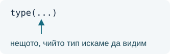

# Променливи

```python
x = 5
```

- Име на променливата: `x`
- Стойност на променливата: `5`

```python
neshto = -54256
```

- Име на променливата: `neshto`
- Стойност на променливата: `-54256`

```python
drugo_neshto = "nqkakuv tekst"
```

- Име на променливата: `drugo_neshto`
- Стойност на променливата: `"nqkakuv tekst"`

## 1. Отдясно на равното

Всичко, което е написано отдясно на равното се "пресмята" (evaluate), за да се получи една единствена стойност накрая.

```python
x = 3 * (5 + 3) - 10
```

Отдясно на равното стои: `3 * (5 + 3) - 10`

`3 * (5 + 3) - 10` се пресмята:

```text
3 * 8 - 10
24 - 10
```

`14` — единствена стойност

```python
x = 5
y = x + x * 2 - 12
```

Отдясно на равното стои: `x + x * 2 - 12`

`x + x * 2 - 12` се пресмята:

```text
5 + 5 * 2 - 12
5 + 10 - 12
15 - 12
```

`3` — единствена стойност

```python
neshto = "qbulki"
drugo_neshto = "Obicham " + neshto
```

Отдясно на равното стои: `"Obicham " + neshto`

`"Obicham " + neshto` се пресмята:

```text
"Obicham " + "qbulki"
```

`"Obicham qbulki"` — единствена стойност

## 2. Отляво на равното

Отляво на равното може да има само едно име на променлива и нищо друго.

```python
x = 5  # валидно
x + 3 = 5  # НЕвалидно
3 = y  # НЕвалидно
```

## 3. Типове променливи

### `int` (от integer, цяло число)

```python
x = 5
y = -513
z = 0
a = 9354198375813741341
```

### `str` (от string, последователност от символи)

```python
x = "alabala"
y = "moje i chisla 431439 i tekst i vsqkakvi simboli !?...;        (())"
z = ""
```

### `float` (floating point number, с "плаваща" точка, нецяло число)

```python
x = 3.14
y = -0.00000004
z = 100.0
```

### `bool` (от boolean, на български булев, истина или лъжа)

```python
x = True
y = False
```

### 3.1. Как можем да видим типа на дадена променлива / стойност?

С функцията `type`



```python
x = 88
type(x)  # int
x = "alabala"
type(x)  # str
x = False
type(x)  # bool
x = 5.904314
type(x)  # float
type(-4)  # int
type("haha")  # str
type(6 + 12 * 0.12)  # int
```
