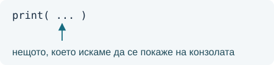

# `print`

Функция, с която се показва ("принтира") нещо на конзолата.



```python
print(12)
```

**На конзолата:**

```text
12
```

```python
print("hello")
```

**На конзолата:**

```text
hello
```

```python
x = 9
print(x)
x = 10
print(x)
print(x)
```

**На конзолата:**

```text
9
10
10
```

## 1. Между скобите на `print`

Това, което напишем между скобите на `print`, се "пресмята" (evaluate), за да се получи една единствена стойност накрая

```python
print(3 + 6 * 2)
```

Между скобите стои: `3 + 6 * 2`

`3 + 6 * 2` се пресмята:

```text
3 + 12
```

`15` — единствена стойност

```python
x = 12
y = 5
print(x + y - 3)
```

Между скобите стои: `x + y - 3`

`x + y - 3` се пресмята:

```text
12 + 5 - 3
17 - 3
```

`14` — единствена стойност

```python
neshto = "banani"
drugo_neshto = "qbulki
print(drugo_neshto + " i " + neshto)
```

Между скобите стои: `drugo_neshto + " i " + neshto`

`drugo_neshto + " i " + neshto` се пресмята:

```text
"qbulki" + " i " + "banani"
"qbulki i " + "banani"
```

`"qbulki i banani"` — единствена стойност
