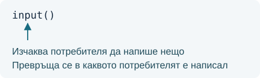
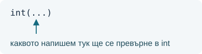
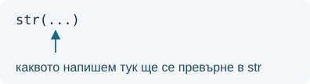

# `input`

Функция, която позволява на потребителя да напише нещо на конзолата



```python
print("Hey, how old are you?")
input()
print("Cool. I'm 26.")
```

```python
print("Hey, how old are you?")
age = input()
print("Cool, I am also " + age)
```

## 1. `input()` винаги ни дава стойност от тип `str`

Ако знаем, че потребителят ще напише число, можем да превърнем стойността от `str` в `int` с функцията `int`:



```python
x = int("12")
print(x + 3)  # 15
```

```python
x = "8"
y = int(x + "2")
print(y + 2)  # 84
```

Как можем да използваме `int(...)` заедно с `input()` ?

```python
print("Hey, how old are you?")
age = int(input())
born = 2026 - age
print("So you were born in " + born)  # Невалидно, виж по-долу
```

Ако искаме да превърнем стойност от `int` в `str`, можем да ползваме функцията `str`:



```python
x = 5
y = str(x) + "12"
print(x)  # 512
```

```python
print("Hey, how old are you?")
age = int(input())
born = 2026 - age
print("So you were born in " + str(born))
```
