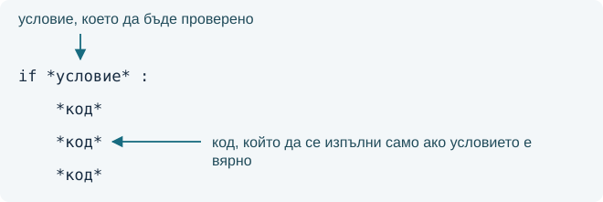

# `if`

Означава "ако" и изпълнява код само когато дадено условие е вярно.



```python
x = 5
if x < 10:
    print("hmm")
```

**На конзолата:**

```text
hmm
```

```python
x = 22
if x < 10:
    print("hmm")
```

**На конзолата:**

```text

```

```python
print("Enter a number:")
x = int(input())
if x < 0:
    print("You entered a negative number.")
if x > 0:
    print("You entered a positive number.)
```
