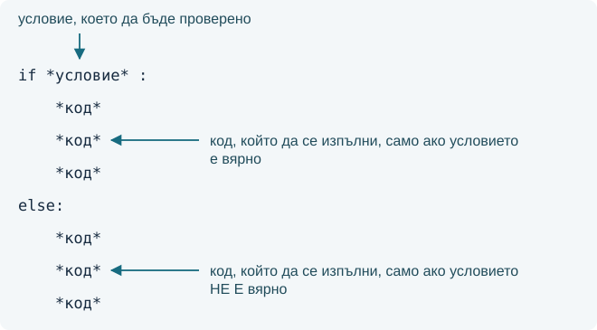

# `else`

Означава "иначе", върви винаги с `if`, и изпълнява код само когато условието на `if` НЕ Е вярно



```python
print("Enter your age:")
age = int(input())
if age < 18:
    print("You are too young to drive.")
else:
    print("You are old enough to drive.")
```
