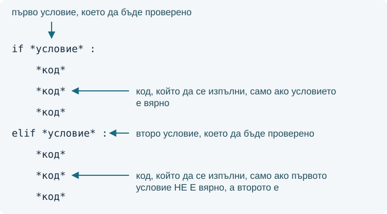

# `else if`

Означава "иначе ако", върви винаги с `if`, и изпълнява код само когато условието на `if` НЕ Е вярно, а дадено друго условие Е вярно.



```python
print("Enter your age:")
age = int(input())
if age < 18:
    print("Underage")
elif age < 64:
    print("Adult")
else:
    print("Retired")
```
